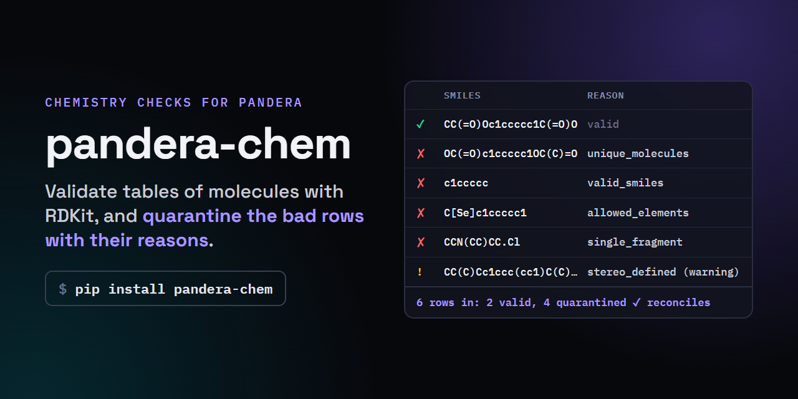
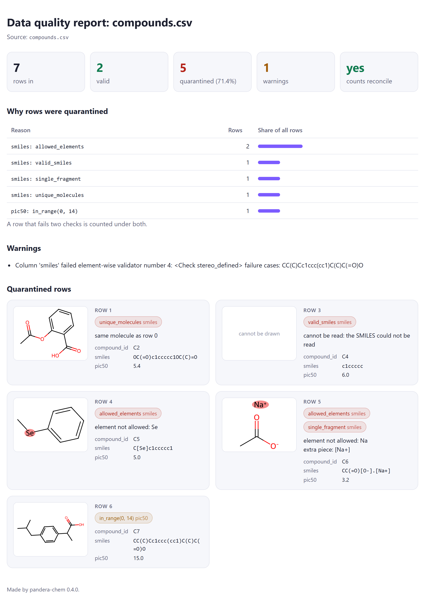

<p align="center">
  
</p>

<p align="center">
  <a href="https://github.com/David-Alobo/pandera-chem/actions/workflows/ci.yml"></a>
  
  <a href="https://github.com/astral-sh/ruff"></a>
  <a href="LICENSE"></a>
  <a href="CITATION.cff"></a>
</p>

**Chemistry checks for [Pandera](https://pandera.readthedocs.io/).** Validate tables of molecules
with [RDKit](https://www.rdkit.org/) inside the data pipeline you already have, and set the bad rows
aside with the reason each one failed, instead of crashing or losing them.

## Why

Chemical tables arrive with problems a type check cannot see: SMILES that RDKit cannot read, salts
and mixtures, unexpected elements, charged forms, missing stereochemistry, and the same molecule
twice under different SMILES. The usual fix is a loop that drops what fails to parse, and the
records vanish with no reason recorded.

pandera-chem turns those problems into Pandera checks, so they sit in the same schema as your other
rules (types, ranges, units), and adds `split()`, which keeps the good rows, sets the bad ones aside
with their reasons, and gives you counts that must add up.

## Install

```bash
pip install pandera-chem
```

or `uv add pandera-chem` (in a notebook: `!pip install pandera-chem`). It needs Python 3.11 or
newer, and installs Pandera and RDKit.

## Example

A table of measured compounds, with a few of the problems real data has:

<!-- example: examples/quickstart.py -->
```python
import pandas as pd
import pandera.pandas as pa

import pandera_chem as pc

table = pd.DataFrame(
    {
        "compound_id": ["C1", "C2", "C3", "C4", "C5", "C6", "C7"],
        "smiles": [
            "CC(=O)Oc1ccccc1C(=O)O",  # aspirin
            "OC(=O)c1ccccc1OC(C)=O",  # aspirin again, written differently
            "c1ccc2ccccc2c1",  # naphthalene
            "c1ccccc",  # a ring that never closes
            "C[Se]c1ccccc1",  # selenium
            "CC(=O)[O-].[Na+]",  # a salt
            "CC(C)Cc1ccc(cc1)C(C)C(=O)O",  # ibuprofen, stereocentre not given
        ],
        "pic50": [5.2, 5.4, 4.1, 6.0, 5.0, 3.2, 15.0],
    }
)

schema = pa.DataFrameSchema(
    {
        "compound_id": pa.Column(str, unique=True),
        "smiles": pa.Column(
            str,
            [
                pc.valid_smiles(),
                pc.allowed_elements(),
                pc.single_fragment(),
                pc.unique_molecules(),
                pc.stereo_defined(raise_warning=True),  # a warning, not a failure
            ],
        ),
        "pic50": pa.Column(float, pa.Check.in_range(0, 14)),
    }
)

result = pc.split(table, schema)
print(result.report)
print()
print(result.quarantined[["compound_id", "reasons"]].to_string(index=False))
print()
print(pc.problems("c1ccccc"))
```

It prints:

```text
7 rows in: 2 valid, 5 quarantined
       2  smiles: allowed_elements
       1  smiles: valid_smiles
       1  smiles: single_fragment
       1  smiles: unique_molecules
       1  pic50: in_range(0, 14)
  warning: Column 'smiles' failed element-wise validator number 4: <Check stereo_defined> failure cases: CC(C)Cc1ccc(cc1)C(C)C(=O)O

compound_id                                           reasons
         C2                          smiles: unique_molecules
         C4                              smiles: valid_smiles
         C5                          smiles: allowed_elements
         C6 smiles: allowed_elements; smiles: single_fragment
         C7                            pic50: in_range(0, 14)

['the SMILES could not be read']
```

- **`result.valid`**: the rows that passed (aspirin and naphthalene), ready for the next step.
- **`result.quarantined`**: the rest, unchanged, with a `reasons` column. Save it, fix the records
  and run them again.
- **`result.report`**: the counts. `result.report.reconciles` is `True` when every row is accounted
  for (rows in = valid + quarantined); log it with every run.
- Ibuprofen passed with a **warning**: its stereocentre is not given, which you may accept for a
  racemate. Any check becomes a warning with `raise_warning=True`.

The checks work in plain Pandera too: `schema.validate(table)` raises an error naming the check that
failed, as Pandera always does.

## Rules files and the command line

The same rules can live in a YAML file next to your data, and be run without writing Python. Each
check is a name, or a name with its arguments:

<!-- file: examples/rules.yaml -->
```yaml
# Rules for a table of measured compounds.
columns:
  compound_id:
    dtype: str
    unique: true
  smiles:
    dtype: str
    checks:
      - valid_smiles
      - allowed_elements
      - single_fragment
      - unique_molecules
      - stereo_defined: {raise_warning: true}
  pic50:
    dtype: float
    checks:
      - in_range: {min_value: 0, max_value: 14}
```

<!-- command: pandera-chem check examples/compounds.csv --rules examples/rules.yaml --out report -->
```bash
pandera-chem check examples/compounds.csv --rules examples/rules.yaml --out report
```

```text
7 rows in: 2 valid, 5 quarantined
       2  smiles: allowed_elements
       1  smiles: valid_smiles
       1  smiles: single_fragment
       1  smiles: unique_molecules
       1  pic50: in_range(0, 14)
  warning: Column 'smiles' failed element-wise validator number 4: <Check stereo_defined> failure cases: CC(C)Cc1ccc(cc1)C(C)C(=O)O
wrote report/compounds.{valid.csv,quarantine.csv,report.html,report.json}
FAIL: 71.4% of rows quarantined (allowed: 0.0%)
```

It writes the valid rows, the quarantined rows with their reasons, and a **report card**: a web page
with the counts, the reasons and a card for each bad row, with a **picture of the molecule and what
is wrong highlighted** (the disallowed atom, the counter-ion, the forbidden group, the stereocentre
with no configuration), and the same as JSON. It ends with exit code 1 when
more rows are quarantined than `--max-quarantined` allows (none, unless you say otherwise), so it can
stop a CI job. It reads CSV, TSV, Parquet and SDF files. `pandera-chem init` writes a starter rules
file to edit.

<p align="center"></p>

**Next: the [usage guide](docs/usage.md)** shows checking strictly, running pandera-chem in a
pipeline (saving the quarantine, logging, stopping a bad run), rules for a screening library,
tables with InChIKeys, writing a check of your own, rules files and the command line in detail, and
a GitHub Actions job.

## The checks

On a column of SMILES:

| Check | Fails when |
|---|---|
| `valid_smiles()` | RDKit cannot read or sanitise the SMILES (syntax, valence, aromaticity) |
| `allowed_elements(elements=ORGANIC)` | an atom is not in the allowed set (default: H, B, C, N, O, F, P, S, Cl, Br, I) |
| `single_fragment()` | the record holds more than one molecule: a salt, a solvent or a mixture |
| `neutral()` | the net formal charge is not zero (charges that cancel, as in a nitro group, are fine) |
| `stereo_defined()` | a stereocentre or stereogenic double bond has no configuration given |
| `heavy_atoms(min_value, max_value)` | the largest fragment has too few or too many heavy atoms |
| `mol_weight(max_value, min_value=0)` | the largest fragment is too light or too heavy (g/mol) |
| `no_substructures({"name": "SMARTS", ...})` | the molecule contains one of the given groups |
| `unique_molecules()` | the same molecule appeared in an earlier row, even as a different SMILES |

On InChIKeys:

| Check | Fails when |
|---|---|
| `inchikey_format()` | the value is not shaped like a standard InChIKey |
| `inchikey_matches("smiles", "inchikey")` | (table-wide) a row's InChIKey is not the one its SMILES gives |

On activity data (IC50, Ki, EC50...), with `pip install "pandera-chem[units]"`, which adds
[pint](https://pint.readthedocs.io/) to read units:

| Check | Fails when |
|---|---|
| `concentration_units()` | the unit is not a molar concentration, however it is spelled: `ug/mL` (a mass per volume), `nm` (a nanometre, a common slip for nM), `%`, `n/a` |
| `pchembl_matches("value", "units", "pchembl")` | (table-wide) the stored pChEMBL is not 9 − log10(value in nM); with `relation_column=`, only exact ("=") values are compared |
| `activity_in_range("value", "units")` | (table-wide) the value, converted to nM, is below 1 pM or above 1 M (or zero or negative): usually a unit slip |

Every check can be named in a rules file, as can Pandera's own `in_range`, `isin`, `notin`, `gt`,
`ge`, `lt`, `le`, `eq`, `ne` and `str_*` checks.

Helpers: `pc.problems(smiles)` says why a SMILES cannot be read, in RDKit's words;
`pc.inchikey(smiles)` gives its standard InChIKey; `pc.clear_cache()` frees the parsed molecules;
`pc.load_schema(path)` builds a schema from a rules file; `pc.report_html(result)` and
`pc.report_json(result)` make the report card.

## How it works

- **One reason per problem.** Only `valid_smiles()` fails a SMILES that cannot be read; every other
  check lets it pass. A broken record is reported once, as unreadable, not under every check.
- **Each SMILES is read once.** All the checks share one cache of parsed molecules, so five checks on
  a column cost about one parse per distinct SMILES. Call `pc.clear_cache()` after a very large table.
- **Pandera's own options work.** Every check accepts them: `raise_warning=True`,
  `n_failure_cases=10` and so on.
- **Nothing is changed.** pandera-chem checks molecules; it never alters them. To repair records
  (strip salts, neutralise charges, pick one tautomer), use RDKit's
  [MolStandardize](https://www.rdkit.org/docs/source/rdkit.Chem.MolStandardize.rdMolStandardize.html)
  or the [ChEMBL structure pipeline](https://github.com/chembl/ChEMBL_Structure_Pipeline) first, then
  check the result. For a web page that validates an uploaded file, see
  [ChemAudit](https://nfdi4chem.de/introducing-chemaudit/).

## Roadmap

Ideas for later versions; [suggest one](https://github.com/David-Alobo/pandera-chem/issues/new?template=feature.yml).

- Polars data frames, which Pandera also supports.
- The ChEMBL structure checker as a check, with a penalty threshold.
- Pydantic types for single records (`SMILES`, `InChIKey`).
- More activity checks (assay types, relations), and converting mass units with a molecular weight.

## Learn the ideas behind it

pandera-chem grew out of the free course
[Data Engineering for Cheminformatics](https://monstrous.com.ng/learn/), which builds these checks by
hand: validating molecules in Module 6, the quarantine in Module 10, and validating whole tables with
Pydantic and Pandera in Module 12.

## Contributing

Bug reports, suggestions and pull requests are welcome: see [CONTRIBUTING.md](CONTRIBUTING.md).
Everyone taking part follows the [code of conduct](CODE_OF_CONDUCT.md). Every example in this README
and the usage guide is run by the tests, which check that the page shows what it really prints.

## Citing

If pandera-chem helps your research, please cite it: GitHub's **Cite this repository** button (from
[CITATION.cff](CITATION.cff)) gives the reference in APA and BibTeX.

## Licence

MIT ([LICENSE](LICENSE)). Made by [Monstrous Data](https://monstrous.com.ng).
